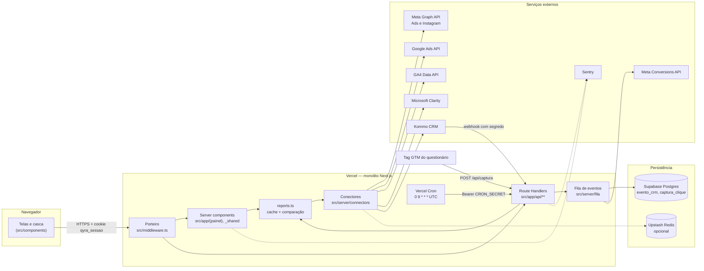
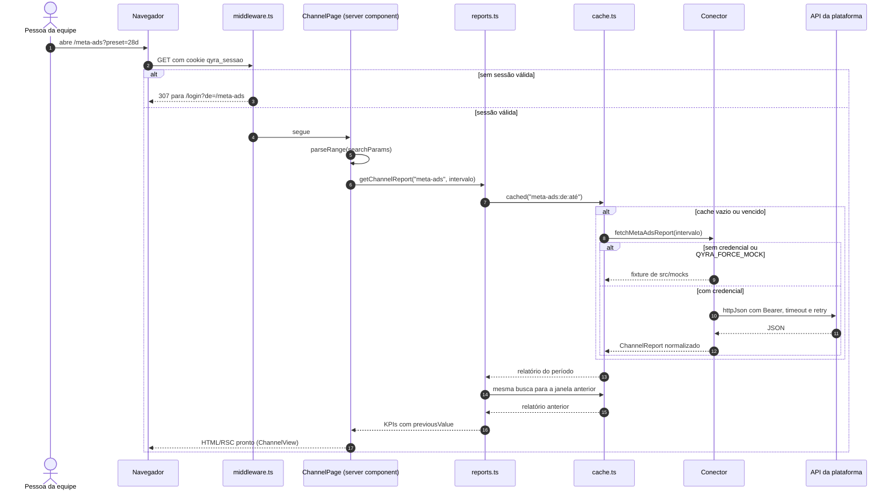
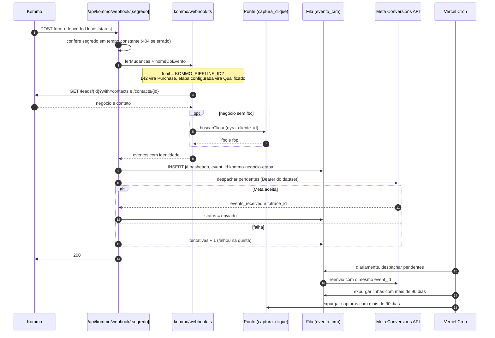

# Arquitetura — dashboard QYRA

Mapa técnico do repositório. Escrito a partir do código, não de intenção: cada
afirmação aqui aponta para um arquivo. Onde já existe documento detalhado, este
mapa resume e linka — o detalhe mora lá.

| Para entender… | Leia |
|---|---|
| Camadas e decisões de projeto | [`docs/arquitetura.md`](docs/arquitetura.md) |
| Credencial de cada plataforma | [`docs/integracoes.md`](docs/integracoes.md) |
| Modelo de ameaça e achados abertos | [`docs/seguranca.md`](docs/seguranca.md) |
| Identificador de clique até o negócio | [`docs/captura-fbc.md`](docs/captura-fbc.md) |
| Ponte `cliente_id → fbc` | [`docs/ponte-captura.md`](docs/ponte-captura.md) |
| Esteira, observabilidade, performance | [`docs/qualidade.md`](docs/qualidade.md) |
| Vercel, ambientes, domínio | [`docs/deploy.md`](docs/deploy.md) |
| Contrato de contribuição | [`AGENTS.md`](AGENTS.md) |

---

## 1. Visão geral e stack tecnológica

Painel de desempenho de mídia da QYRA. Lê Meta Ads, Google Ads, GA4, orgânico
de Instagram/Facebook, Microsoft Clarity e o CRM Kommo, e consolida tudo numa
visão geral e numa tela por fonte. Uma única integração **escreve**: os eventos
de CRM que vão para a Meta pela API de Conversões.

Sem credencial nenhuma o painel roda em **modo de demonstração**, com fixtures
determinísticas de `src/mocks/`. A CI roda sempre assim (`QYRA_FORCE_MOCK=true`).

### Linguagens e runtimes

Versões **instaladas** (`package-lock.json` / `node_modules`) e, entre
parênteses, a faixa **declarada** no `package.json`.

| Item | Versão | Onde está definido |
|---|---|---|
| TypeScript | 5.9.3 (`^5.7.0`) | `tsconfig.json`: `strict`, `target` ES2022, `moduleResolution` bundler, alias `@/*` → `src/*` |
| Node.js | `>=20.11` declarado em `engines`; **22** na CI | `package.json`, `.github/workflows/ci.yml` |
| Runtime das rotas | Node.js (`export const runtime = "nodejs"` nas rotas de API) | `src/app/api/**/route.ts` |
| Runtime do porteiro | Edge do Next (convenção `middleware`); usa só Web Crypto | `src/middleware.ts`, `src/server/auth/sessao.ts` |
| SQL | PostgreSQL (Supabase) | `docs/sql/*.sql` |

### Frameworks e bibliotecas principais

| Camada | Biblioteca | Versão instalada (declarada) | Para quê |
|---|---|---|---|
| Framework | **Next.js** (App Router, server components, Route Handlers) | 16.3.8 (`^16.3.8`) | Telas e backend HTTP no mesmo projeto |
| UI | **React** / React DOM | 19.1.0 (`19.1.0`) | Renderização |
| Estilização | **Tailwind CSS** + `@tailwindcss/postcss` | 4.3.3 (`^4.0.0`) | Tokens da marca em `src/app/globals.css` |
| Primitivas | Radix UI (`react-popover`, `react-slot`, `react-tooltip`) | 1.1.23 / 1.3.3 / 1.2.16 | Padrão shadcn/ui em `src/components/ui/` |
| Variantes e classes | `class-variance-authority`, `clsx`, `tailwind-merge` | 0.7.1 / 2.1.1 / 2.6.1 | `src/lib/cn.ts`, botões e selos |
| Gráficos | **Recharts** | 2.15.4 (`^2.15.0`) | Carregado por `next/dynamic` (`src/components/charts/lazy.tsx`) |
| Ícones | `lucide-react` | 0.460.0 | |
| Tema | `next-themes` | 0.4.6 | Claro/escuro por `data-theme` |
| Validação | **zod** | 3.25.76 (`^3.24.1`) | Schema do ambiente (`src/server/env.ts`) |
| Fronteira | `server-only` | 0.0.1 | Quebra o build se módulo de servidor chegar ao cliente |
| Observabilidade | **@sentry/nextjs** | 10.70.0 (`^10.70.0`) | Erro e tracing; só inicializa com DSN |
| Fontes | `next/font/google` (Poppins, Fraunces) | — | Substitutos livres de Gilroy/Larken |

**Estado.** Não há biblioteca de estado global. O período filtrado vive na URL
(`?preset=` ou `?from=&to=`, lido por `parseRange` em `src/lib/date-range.ts`),
os dados são buscados no servidor e chegam por props. No cliente há só estado
local de componente (`useState`, `useTransition` no filtro de datas).

**Sem SDK de plataforma.** Todo conector é `fetch` sobre REST, com a política
única de `src/server/lib/http.ts`. Supabase e Redis também.

### Banco de dados e persistência

| Tecnologia | Uso | Acesso |
|---|---|---|
| **Supabase (PostgreSQL)** | Duas tabelas: `evento_crm` (fila da API de Conversões) e `captura_clique` (ponte de captura) | PostgREST via `fetch`, chave `service_role` (`src/server/lib/supabase.ts`). **Sem ORM** |
| **Upstash Redis** (opcional) | Última leitura boa do Clarity, por 7 dias | REST via `fetch` (`src/server/lib/memoria.ts`) |
| Data Cache do Next | Respostas do Clarity, por 6 h, compartilhado entre instâncias | `next: { revalidate }` em `httpJson` |
| `Map` em memória | Cache de relatório (TTL `REPORT_CACHE_TTL`), rate limit, token OAuth do Google | Por instância |

O esquema está em [`docs/sql/evento-crm.sql`](docs/sql/evento-crm.sql) e
[`docs/sql/captura-clique.sql`](docs/sql/captura-clique.sql), aplicado à mão no
SQL Editor do Supabase. Não há ferramenta de migração. As duas tabelas têm RLS
ligado **sem política**: só a `service_role` lê e escreve.

Dado de negócio (investimento, leads, receita) **não é persistido** — é buscado
na origem a cada requisição, com cache curto em memória.

### Ferramentas de build e infraestrutura

| Área | Ferramenta | Arquivo |
|---|---|---|
| Build | `next build` (Turbopack, padrão do Next 16) | `next.config.ts` |
| CSS | PostCSS + `@tailwindcss/postcss` | `postcss.config.mjs` |
| Hospedagem | **Vercel**, conectada ao GitHub: PR gera preview, `main` publica | `vercel.json`, [`docs/deploy.md`](docs/deploy.md) |
| Agendamento | Vercel Cron: `/api/cron/eventos-crm` às `0 9 * * *` (UTC, 6h em Brasília) | `vercel.json` |
| Docker | **Não há.** Nenhum `Dockerfile` ou `compose` no repositório | — |
| CI | GitHub Actions: `ci.yml` (todo PR e push na `main`), `mutation.yml` (segunda, 06:00 UTC, e sob demanda) | `.github/workflows/` |
| Lint e formatação | Biome 2.5.9 | `biome.json` |
| Contrato de arquitetura | dependency-cruiser 18.2.0 | `.dependency-cruiser.cjs` |
| Código morto | Knip 6.32.2 | `knip.json` |
| Testes | Vitest 4.1.11 (jsdom 30.0.1, Testing Library), Playwright 1.62.1 | `vitest.config.mts`, `playwright.config.ts` |
| Cobertura | `@vitest/coverage-v8` + Codecov (patch ≥ 80%) | `codecov.yml` |
| Mutação | Stryker 10.0.0 | `stryker.config.mjs` |
| Performance | Lighthouse CI 0.15.1 | `.lighthouserc.json` |
| Segredo e dependência | gitleaks 8.24.3 (baixado na CI), `npm audit` | `ci.yml` |
| Ganchos locais | husky 9.1.7 + commitlint 21.2.2 | `.husky/`, `commitlint.config.mjs` |

Jobs da CI: `qualidade` (tipos, Biome, arquitetura, Knip), `testes` (Vitest com
cobertura → Codecov), `e2e` (build + Playwright), `performance` (build +
Lighthouse) e `seguranca` (`npm audit` crítico bloqueante, relatório completo
informativo, gitleaks no histórico inteiro). Detalhes em
[`docs/qualidade.md`](docs/qualidade.md).

---

## 2. Arquitetura da aplicação

### Padrão arquitetural

**Monolito Next.js em camadas, implantado como funções serverless na Vercel.**
Telas e API vivem no mesmo projeto. Não há serviço separado, fila gerenciada
nem worker: o que é assíncrono é resolvido por webhook de entrada, tabela no
Supabase e um cron diário.

Quatro decisões dão a forma:

1. **Busca no servidor.** As telas são server components. O segredo não sai do
   backend e o HTML chega pronto.
2. **Contrato único de dado.** Todo conector de relatório devolve
   `ChannelReport` (`src/lib/types.ts`). A UI só conhece esse formato.
3. **Ponto único de acesso.** Nenhuma tela chama conector direto:
   `src/server/reports.ts` aplica cache, comparação com o período anterior e
   degradação de erro igual para todos.
4. **Fronteira cravada na CI.** `components/` nunca importa `server/`
   (`.dependency-cruiser.cjs`), e `server/**` importa `server-only`.

| Camada | Pode depender de |
|---|---|
| `src/app/` | tudo |
| `src/components/` | só `src/lib/` |
| `src/server/` | `src/lib/`, `src/mocks/` |
| `src/mocks/` | só `src/lib/` |
| `src/lib/` | nada do projeto |

O porquê de cada decisão está em [`docs/arquitetura.md`](docs/arquitetura.md).

### Estrutura de pastas

```
.
├── ARCHITECTURE.md            este mapa
├── AGENTS.md                  contrato de contribuição (fonte da verdade)
├── next.config.ts             CSP, HSTS e demais cabeçalhos; /api/* em no-store
├── vercel.json                framework e cron diário
├── .env.example               variáveis, com uma linha explicando cada uma
├── .dependency-cruiser.cjs    quem pode importar quem
├── docs/
│   ├── sql/                   DDL das duas tabelas do Supabase
│   └── legal/                 termos e privacidade (minuta, pendente de jurídico)
├── public/brand/              arte estática da marca
├── tests/
│   ├── unit/                  lógica pura e componentes (Vitest + Testing Library)
│   ├── integration/           conectores com fetch substituído, rotas, fila
│   ├── e2e/                   Playwright: login, percursos, porta, a11y, responsivo
│   └── stubs/server-only.ts   torna `server-only` no-op no Vitest
└── src/
    ├── middleware.ts          porteiro: sessão por senha antes de qualquer rota
    ├── instrumentation.ts     Sentry no servidor (Node e Edge)
    ├── instrumentation-client.ts  Sentry no navegador, import dinâmico
    ├── app/                   rotas do App Router
    │   ├── layout.tsx         raiz: fontes, metadados, tema
    │   ├── (painel)/          telas com a casca de navegação (grupo, fora da URL)
    │   ├── _shared/           server components que buscam dado (pasta privada)
    │   ├── login/             tela de login e Server Action de saída
    │   ├── api/
    │   │   ├── v1/            contrato HTTP público dos relatórios
    │   │   ├── health/        prontidão e presença de variáveis
    │   │   ├── sessao/        POST do formulário de login
    │   │   ├── kommo/webhook/ entrada do Kommo (segredo no caminho)
    │   │   ├── cron/          varredura diária da fila
    │   │   ├── captura/       ponte de captura, chamada pelo navegador
    │   │   └── diagnostico/   meta, google, kommo, capi, fila, utm
    │   ├── criativos/[id]/imagem/    proxy da arte de anúncio da Meta
    │   └── publicacoes/[id]/imagem/  proxy da arte de publicação do Instagram
    ├── components/            UI; não conhece rede nem segredo
    │   ├── ui/                primitivas (card, botão, tabela, StatTile…)
    │   ├── charts/            Recharts e paleta por slot
    │   ├── layout/            casca, barra lateral, filtro de período, avisos
    │   ├── report/            ChannelView, funil, criativos, Clarity, status
    │   └── brand/             logo e grafismos
    ├── server/                backend; todo módulo com segredo importa `server-only`
    │   ├── env.ts             schema zod do ambiente, lido sob demanda
    │   ├── reports.ts         ponto único de acesso a relatório
    │   ├── connectors/        um arquivo por plataforma
    │   ├── auth/              assinatura e conferência do cookie de sessão
    │   ├── kommo/             webhook, conferência de captura, conclusão do diagnóstico
    │   ├── fila/              fila de eventos de CRM e placar de atribuição
    │   ├── captura/           ponte cliente_id → fbc
    │   ├── diagnostico/       auditoria de UTM e veredito do token do Google
    │   └── lib/               http, cache, rate limit, api, OAuth Google, Supabase, Redis
    ├── lib/                   puro: tipos, canais, datas, formatação, identidade, avisos
    └── mocks/                 fixtures determinísticas (hash FNV-1a)
```

---

## 3. Módulos do sistema

### 3.1 Porteiro e sessão

**Propósito.** Fechar o painel inteiro — telas, `/api` e diagnósticos — atrás
de uma senha compartilhada pela equipe.

**Componentes.**

| Arquivo | Papel |
|---|---|
| `src/middleware.ts` | Roda antes de toda rota. Libera caminhos públicos (`ehPublico`), confere o cookie, redireciona para `/login?de=…` |
| `src/server/auth/sessao.ts` | `senhaConfere` (tempo constante), `criarToken`, `tokenValido` (HMAC-SHA256 por Web Crypto). Não é `server-only` porque roda no middleware |
| `src/app/api/sessao/route.ts` | `POST` do formulário nativo: confere origem, rate limit de 10 tentativas por IP a cada 10 min, grava o cookie, responde 303 |
| `src/app/login/page.tsx`, `actions.ts` | Tela de login e Server Action `sair` |

**Fluxo de dados.** Formulário → `POST /api/sessao` → senha confere →
cookie `qyra_sessao` = `<expiraEm>.<HMAC(expiraEm)>`, `httpOnly`, `sameSite=lax`,
7 dias → toda requisição seguinte passa por `tokenValido`. A chave é
`QYRA_SESSAO_SECRET` ou, sem ela, a própria `QYRA_SENHA`. Sem `QYRA_SENHA` em
produção, tudo fica trancado (só `/api/health` responde).

**Caminhos fora do porteiro:** `/login`, `/api/sessao`,
`/api/kommo/webhook/*`, `/api/cron/eventos-crm`, `/api/captura` e estáticos.
Cada um tem a própria autenticação (seção 4). Detalhe e parâmetros em
[`docs/seguranca.md`](docs/seguranca.md).

### 3.2 Relatórios de canal (orquestração)

**Propósito.** Entregar a cada tela um `ChannelReport` com cache, comparação
e falha isolada por canal.

**Componentes.**

| Arquivo | Papel |
|---|---|
| `src/server/reports.ts` | `FETCHERS` por canal, `getChannelReport`, `getAllReports`, `getOverviewReport`, `getStatusDeVendas`, `getClarityResumo` |
| `src/server/lib/cache.ts` | `cached(chave, loader, ttl)`: `Map` com TTL, teto de 200 entradas |
| `src/lib/types.ts` | `ChannelReport`, `OverviewReport`, `Kpi`, `TableBlock`, `FunnelBlock`, `Notice` |
| `src/lib/channels.ts` | `CHANNELS` (4 canais de aquisição, com slot de cor) e `RELATORIOS` (+ Vendas) |
| `src/lib/date-range.ts` | Presets 7d/14d/28d/90d terminando ontem; `previousRange` para a comparação |
| `src/lib/avisos.ts` | `avisoCliente` (vai para a tela) e `avisoOperacao` (fica no payload) |

**Fluxo de dados.** `searchParams` → `parseRange` → `getChannelReport(canal,
intervalo)` → `cached("canal:de:até")` → conector → (sem credencial ou
`QYRA_FORCE_MOCK`) fixture → segundo `cached` para a janela anterior →
`previousValue` dos KPIs vem do KPI homônimo, nunca da soma da série. A visão
geral chama `getAllReports` para os quatro canais de `CHANNELS` em paralelo; um
canal que falha vira `{ report: null, error }` e um aviso de operação.

### 3.3 Telas (App Router)

**Propósito.** Server components que leem o período da URL, buscam no servidor
e entregam a composição pronta à UI.

| Rota | Arquivo | Fonte |
|---|---|---|
| `/` | `src/app/(painel)/page.tsx` | `getOverviewReport` |
| `/meta-ads`, `/google-ads`, `/analytics`, `/organico`, `/vendas` | `src/app/(painel)/<rota>/page.tsx` → `ChannelPage` | `getChannelReport` |
| `/status` | `src/app/(painel)/status/page.tsx` | `getStatusDeVendas` (Kommo) |
| `/comportamento` | `src/app/(painel)/comportamento/page.tsx` | `getClarityResumo` |
| `/login` | `src/app/login/page.tsx` | — |

**Componentes.** `src/app/_shared/channel-page.tsx` é o server component comum
das cinco telas de relatório: busca e passa o dado para `ChannelView`
(`src/components/report/channel-view.tsx`), que monta cabeçalho, avisos,
`StatTile`, funil, gráfico, criativos e tabelas. Cada rota tem `loading.tsx`
com skeleton; `(painel)/error.tsx` cobre a falha. A casca (`AppShell`,
`Sidebar`, `DateRangePicker`) é cliente e só lê/escreve a URL.

**Fluxo de dados.** Clique no filtro → `router.push` com novos
`searchParams` dentro de `useTransition` → o servidor re-renderiza a página →
HTML/RSC volta já com os números. Avisos de operação são filtrados por
`avisosVisiveis` **antes** de chegar ao componente cliente, para não irem
serializados no HTML.

### 3.4 Conectores de leitura

**Propósito.** Um arquivo por plataforma em `src/server/connectors/`. Cada um
decide entre dado real e fixture, consulta a API e normaliza para o contrato.

| Conector | API | Devolve |
|---|---|---|
| `meta-ads.ts` | Marketing API, Insights (`/act_…/insights` nos níveis `account`, `campaign`, `ad`; `/ads` para criativos) | `ChannelReport` |
| `google-ads.ts` | Google Ads REST, `googleAds:searchStream` com GAQL; sonda versões em `VERSOES_CANDIDATAS` | `ChannelReport` |
| `ga4.ts` | GA4 Data API v1beta, `properties/{id}:runReport` | `ChannelReport` |
| `organico.ts` | Graph API, Insights do Instagram (`/{ig-user}/insights` em blocos de 30 dias, `/{ig-user}/media`) | `ChannelReport` |
| `kommo.ts` | Kommo API v4 (`/leads`, `/leads/pipelines`, `/leads/unsorted`, `/contacts`, `/sources`, `/events`) | `ChannelReport` (Vendas) e `StatusDeVendas` |
| `clarity.ts` | Clarity Data Export (`project-live-insights`, 3 dias) | `ClarityEstado` |

**Arquitetura interna comum.** `isForceMock()` ou `getCredentials()` falso →
fixture de `src/mocks/reports.ts` com `avisoOperacao`. Caso contrário,
consultas em paralelo via `httpJson`, agregação em `Map`, dias sem entrega
preenchidos com zero, e montagem de `kpis`, `series`, `seriesDefs`, `tables`,
`funnel` e `creatives`. Falha da API sobe; quem decide o que fazer é
`reports.ts`.

**Particularidades que mudam o fluxo.**

- **Google Ads:** com `GOOGLE_ADS_API_VERSION` vazio, tenta `v22 → v19` e
  memoriza a primeira que responde; só 404 faz tentar a próxima.
- **Kommo:** duas consultas por período (criação e fechamento), paginação de
  250 até 20 páginas, contatos em lotes de 100 em série para a cidade,
  `KOMMO_PIPELINE_ID` restringe o funil. O relatório de Vendas também anexa o
  placar da fila (`src/server/fila/placar.ts`).
- **Clarity:** cota de 10 chamadas por dia. Cache de 6 h no Data Cache do Next
  e em `cached`, sem retry, última leitura boa guardada em
  `src/server/lib/memoria.ts` (Redis opcional) e servida com `defasado: true`.

Regras de cada plataforma, limites e erros comuns em
[`docs/integracoes.md`](docs/integracoes.md).

### 3.5 Infraestrutura de servidor (`src/server/lib/`)

| Arquivo | Papel |
|---|---|
| `http.ts` | `httpJson`: timeout de 15 s, 2 retries com backoff em 408/425/429/5xx e erro de rede, `no-store` por padrão, corpo vazio aceito. `redactSecrets` e `descreverFalha` limpam token de mensagem. `metaAuthHeaders` põe o token em `Authorization: Bearer` |
| `api.ts` | `guard(request)`: rate limit + cabeçalhos `x-ratelimit-*`; `apiError` no formato `{ error: { code, message } }` |
| `rate-limit.ts` | Janela fixa em memória por IP (`x-forwarded-for`). Padrão 60 por 60 s |
| `cache.ts` | Cache TTL por instância |
| `google-auth.ts` | Troca o refresh token por access token; guarda em memória com 60 s de folga |
| `supabase.ts` | `selecionar`, `inserir` (ignora duplicata), `atualizar`, `contar` (via `content-range`), `excluir` |
| `memoria.ts` | `lembrar` / `lembrado`: local + Upstash REST, falha em silêncio |

`src/server/env.ts` valida o ambiente com zod **a cada chamada** (nada é
congelado no build), apara espaços, trata vazio como ausente e remove
`NOME=` colado junto do valor. `getCredentials()` diz quais integrações estão
completas.

### 3.6 Eventos de CRM para a Meta (webhook, fila e cron)

**Propósito.** Mandar para a Meta, pela API de Conversões, quando um lead vira
qualificado ou venda no Kommo — para a Meta otimizar por quem fecha, não por
quem preenche formulário.

**Componentes.**

| Arquivo | Papel |
|---|---|
| `src/app/api/kommo/webhook/[segredo]/route.ts` | Entrada do Kommo. `GET` só confirma a rota; `POST` enfileira e tenta despachar na hora |
| `src/server/kommo/webhook.ts` | `lerMudancas` (corpo `x-www-form-urlencoded`, só `leads[status]`), `nomeDoEvento` (confere funil, `142` → `Purchase`, `KOMMO_ETAPA_QUALIFICADO` → `Qualificado`), `eventosDaMudanca` (busca negócio e contato, completa pela ponte) |
| `src/server/connectors/meta-capi.ts` | `montarUsuario` (normaliza e faz SHA-256 de e-mail, telefone, nome; `fbc`, `fbp` e `lead_id` crus), `enviarPreparados` (lotes de até 1.000) |
| `src/server/fila/eventos-crm.ts` | `enfileirar`, `despachar` (200 por rodada, 5 tentativas), `resumo`, `expurgar` (90 dias) |
| `src/server/fila/placar.ts` | KPI e tabela "Atribuição na Meta" na tela de Vendas |
| `src/app/api/cron/eventos-crm/route.ts` | Varredura diária: despacha, expurga a fila, expurga a ponte |
| `src/lib/identidade.ts` | Normalização de e-mail, telefone, nome; `montarFbc` a partir de `fbclid` |

**Fluxo de dados.** Kommo muda etapa → `POST /api/kommo/webhook/<segredo>` →
mudanças lidas → só etapas de interesse → `GET /leads/{id}?with=contacts` e
`GET /contacts/{id}` no Kommo → identidade (campo `fbc` do negócio primeiro,
ponte depois) → `user_data` já hasheado → `INSERT` em `evento_crm` com
`event_id = kommo-<negócio>-<etapa>` (duplicata ignorada) → `despachar` envia
os pendentes à Meta → linha vira `enviado`, ou soma tentativa e vira `falhou`
na quinta. Sem identificador, a linha entra como `sem_identificador` e nunca
sai. Às 6h o cron repete o despacho e apaga o que passou de 90 dias. Ver o
diagrama 5.3 e [`docs/integracoes.md`](docs/integracoes.md#api-de-conversões-eventos-de-crm-para-a-meta).

### 3.7 Ponte de captura

**Propósito.** Ligar o clique no anúncio à venda sem o questionário mudar,
guardando `cliente_id → fbc` no Supabase.

**Componentes.** `src/app/api/captura/route.ts` (CORS para domínios da Qyra,
corpo de até 4 KB, `OPTIONS` e `POST`), `src/server/captura/ponte.ts`
(`lerCaptura` valida UUID e formato de `fbc`/`fbp`; `registrar` faz upsert
preservando campos; `buscarClique`; `resumoDaPonte`; `expurgar`).

**Fluxo de dados.** Tag no GTM do questionário (fora deste repositório) →
`POST /api/captura` com `cliente_id`, `fbc`, `fbp` e UTMs → linha em
`captura_clique` → na hora do ganho, o webhook lê `qyra_cliente_id` do negócio
e busca o `fbc` aqui. Detalhe e a tag completa em
[`docs/ponte-captura.md`](docs/ponte-captura.md) e
[`docs/captura-fbc.md`](docs/captura-fbc.md).

### 3.8 Diagnóstico e saúde

**Propósito.** Encanamento para quem opera: dizer em qual degrau uma
integração quebra sem expor segredo. Fica atrás da senha.

| Rota | O que faz |
|---|---|
| `GET /api/health` | Presença (nunca valor) de cada variável, vazias, com espaço nas pontas, `getCredentials()`, commit e ambiente da Vercel |
| `GET /api/diagnostico/meta` | Percorre token → conta → insights → Instagram; token mascarado |
| `GET /api/diagnostico/google` | OAuth → Ads (versão, `login-customer-id`) → GA4; `veredictoDoToken` em `src/server/diagnostico/veredicto-ads.ts` |
| `GET /api/diagnostico/kommo` | Funis e etapas com ids, conferência de captura (`src/server/kommo/captura.ts`), ponte e conclusão (`conclusao.ts`) |
| `GET /api/diagnostico/capi` | Envia **um** evento de teste; só roda com `META_CAPI_TEST_EVENT_CODE` |
| `GET /api/diagnostico/fila` | Banco responde? Contagem por status, nunca linhas |
| `GET /api/diagnostico/utm` | Auditoria de UTM dos anúncios da Meta (`src/server/diagnostico/utm-meta.ts`) |

### 3.9 Proxies de imagem

**Propósito.** Servir arte de anúncio e de publicação pelo próprio domínio:
a URL do CDN da Meta leva token assinado e a CSP não abre `img-src` para fora.

`/criativos/[id]/imagem` e `/publicacoes/[id]/imagem` validam id só com
dígitos, consultam a Graph com Bearer, aceitam só host da Meta em `https`,
conferem `content-type` de imagem e devolvem os bytes. Ficam fora de `/api`
para o navegador poder cachear.

### 3.10 UI e design system

**Propósito.** Desenhar o que o servidor já calculou. `src/components/` não
faz fetch nem conhece segredo; recebe tudo por props.

Primitivas em `src/components/ui/`, gráficos em `src/components/charts/`
(Recharts sob demanda, cor por slot fixo da entidade em `palette.ts`),
composições em `src/components/report/`. Tokens e regras em
[`docs/design-system.md`](docs/design-system.md).

### 3.11 Observabilidade

`src/instrumentation.ts` inicializa o Sentry nos runtimes Node e Edge e
exporta `onRequestError`; `src/instrumentation-client.ts` faz o mesmo no
navegador com `import()` dinâmico. Sem `NEXT_PUBLIC_SENTRY_DSN` nada
inicializa. `tracesSampleRate` 0,1, `sendDefaultPii` desligado, `beforeSend`
remove `token`/`key`/`secret` da URL. Erros de rota vão para `console.error`
(registrado pela Vercel).

---

## 4. Integrações externas e APIs

### APIs e serviços de terceiros

| Serviço | Direção | Endpoint base | Módulo |
|---|---|---|---|
| Meta Marketing API (Insights) | leitura | `graph.facebook.com/{META_API_VERSION}` (padrão `v21.0`) | `connectors/meta-ads.ts`, proxy de criativos, diagnósticos `meta` e `utm` |
| Meta Graph API — Instagram Insights | leitura | `graph.facebook.com/{META_API_VERSION}` | `connectors/organico.ts`, proxy de publicações |
| Meta Conversions API | **escrita** | `graph.facebook.com/{META_CAPI_API_VERSION}/{dataset}/events` (padrão `v26.0`) | `connectors/meta-capi.ts` |
| Google OAuth 2.0 | troca de token | `oauth2.googleapis.com/token` | `lib/google-auth.ts` |
| Google Ads API (REST + GAQL) | leitura | `googleads.googleapis.com/{versão}/customers/{id}/googleAds:searchStream` | `connectors/google-ads.ts` |
| GA4 Data API v1beta | leitura | `analyticsdata.googleapis.com/v1beta/properties/{id}:runReport` | `connectors/ga4.ts` |
| Microsoft Clarity Data Export | leitura | `www.clarity.ms/export-data/api/v1/project-live-insights` | `connectors/clarity.ts` |
| Kommo API v4 | leitura | `{KOMMO_SUBDOMAIN}.kommo.com/api/v4` | `connectors/kommo.ts`, `kommo/*` |
| Supabase (PostgREST) | leitura e escrita | `{SUPABASE_URL}/rest/v1` | `lib/supabase.ts` |
| Upstash Redis (REST), opcional | leitura e escrita | `KV_REST_API_URL` ou `UPSTASH_REDIS_REST_URL` | `lib/memoria.ts` |
| Sentry | envio de evento | DSN público | `instrumentation*.ts` |
| Vercel | hospedagem, cron, variáveis | — | `vercel.json` |

Chamam **o painel**: o Kommo (webhook), o agendador da Vercel (cron) e a tag
do Google Tag Manager no questionário (ponte de captura).

### Protocolos e autenticação

Todo tráfego é HTTPS com JSON, salvo onde indicado.

| Integração | Autenticação | Payload |
|---|---|---|
| Meta Ads, Orgânico, proxies | Token de usuário do sistema (`META_ACCESS_TOKEN`) em `Authorization: Bearer` | Query string (`fields`, `time_range`, `level`); resposta JSON paginada por `paging.next` |
| Meta CAPI | Token **do conjunto de dados** (`META_CAPI_ACCESS_TOKEN`), Bearer | `POST { data: [{ event_name, event_time, event_id, action_source: "system_generated", user_data, custom_data }] , test_event_code? }` |
| Google Ads | OAuth de app instalado (refresh token → access token) + cabeçalho `developer-token` + `login-customer-id` opcional | `POST { query: "<GAQL>" }` |
| GA4 | Mesmo OAuth (escopo `analytics.readonly`) | `POST runReport` com dimensões e métricas |
| Clarity | `CLARITY_API_TOKEN`, Bearer | `GET` com `numOfDays` e `dimension1` |
| Kommo | Chave de longa duração de integração privada (`KOMMO_ACCESS_TOKEN`), Bearer | `GET` com filtros por data; respostas HAL (`_embedded`) |
| Supabase | Chave `service_role` em `apikey` e `Authorization: Bearer` | PostgREST: filtros na query (`status=eq.pendente`), `Prefer: resolution=ignore-duplicates` |
| Upstash | Token REST, Bearer | `POST /set/{chave}?EX=` e `GET /get/{chave}` |
| Painel (pessoas) | Senha compartilhada → cookie HMAC `qyra_sessao` | Formulário `x-www-form-urlencoded` em `/api/sessao` |
| Kommo → painel | Segredo no caminho (`KOMMO_WEBHOOK_SECRET`), comparação em tempo constante; 404 sem ele | `x-www-form-urlencoded`, `leads[status][i][id|status_id|pipeline_id]` |
| Vercel Cron → painel | `Authorization: Bearer $CRON_SECRET`; 404 sem ele | `GET` sem corpo |
| GTM → painel | Sem segredo possível: origem na allowlist, UUID, formato de `fbc`/`fbp`, teto de 4 KB | `POST` JSON `{ cliente_id, fbc?, fbp?, utm_* }` |

**API pública do painel.** `GET /api/v1/overview` e
`GET /api/v1/reports/:channel` (`meta-ads`, `google-ads`, `ga4`, `organico`,
`vendas`) aceitam `?preset=7d|14d|28d|90d` ou `?from=&to=` e devolvem
`OverviewReport` / `ChannelReport` em JSON. Erro sai como
`{ error: { code, message } }`; falha do provedor vira 502 com o detalhe
passado por `redactSecrets`. Todas exigem sessão e têm rate limit.

### Webhooks, filas, crons e eventos assíncronos

| Mecanismo | Onde | Gatilho | Efeito |
|---|---|---|---|
| Webhook de entrada | `POST /api/kommo/webhook/[segredo]` | Kommo: "status do lead alterado" | Enfileira `Qualificado`/`Purchase` e tenta despachar |
| Verificação do webhook | `GET /api/kommo/webhook/[segredo]` | Kommo, ao salvar a URL | 200 se o segredo confere, 404 senão |
| Fila | Tabela `evento_crm` no Supabase | Escrita pelo webhook | Estados `pendente`, `enviado`, `sem_identificador`, `falhou` |
| Cron | `vercel.json` → `GET /api/cron/eventos-crm`, `0 9 * * *` UTC | Agendador da Vercel | Despacha atrasados, expurga fila e ponte acima de 90 dias |
| Captura do navegador | `POST /api/captura` | Tag no GTM | Upsert em `captura_clique` |
| CI agendada | `.github/workflows/mutation.yml`, `0 6 * * 1` | GitHub Actions | Stryker semanal |

Não há broker de mensagens nem worker contínuo. A fila não tem trava de
concorrência de propósito: reenvio do mesmo `event_id` é deduplicado pela
Meta.

---

## 5. Diagramas

### 5.1 Arquitetura geral



### 5.2 Fluxo principal: abrir uma tela de canal



### 5.3 Fluxo assíncrono: Kommo → fila → Meta CAPI


